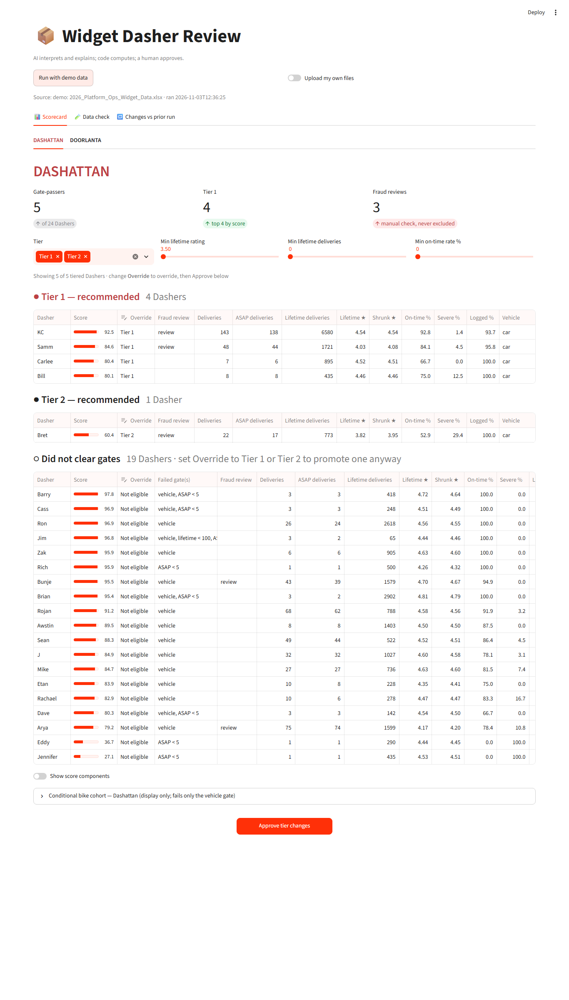
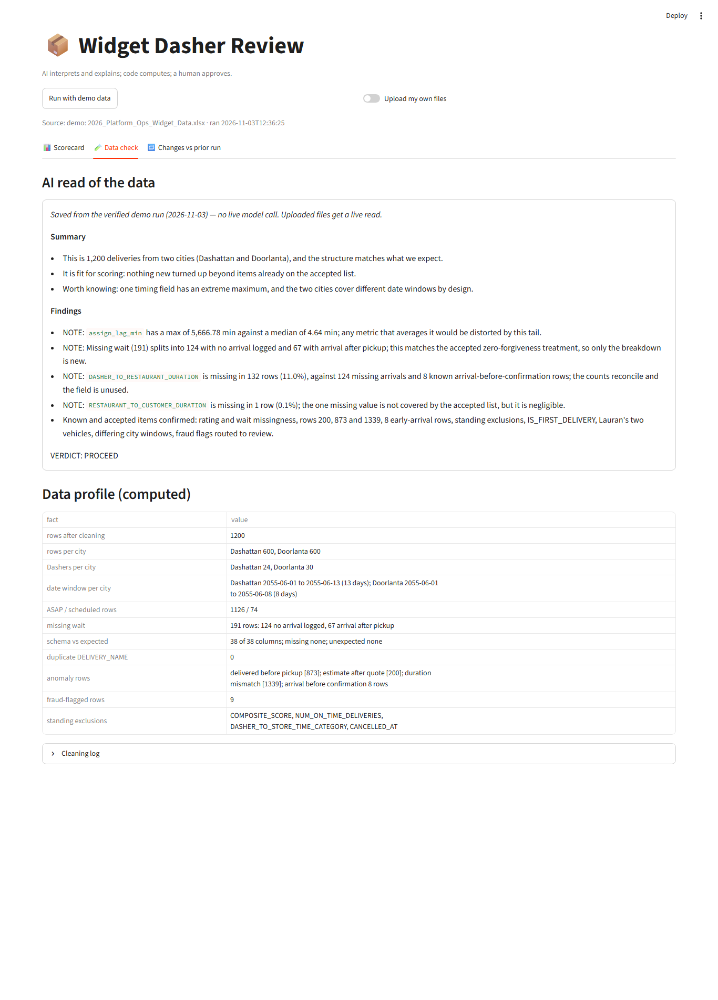
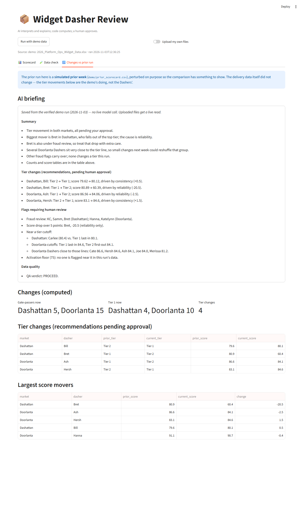

# Widget Dasher Review

**Live app:** https://widget-dasher-review-102588833904.us-central1.run.app — press **Run with demo data**.

A scoring pipeline and review app for selecting Dashers for a widget-delivery launch, built from the
DoorDash case data (`data/2026_Platform_Ops_Widget_Data.xlsx`). The analysis that defined every metric is
`analysis.ipynb` (`analysis_report.pdf` is the same notebook with code hidden); `pipeline.py` carries that logic
as code, `ai.py` adds two explanatory AI stages, and `app.py` puts a human approval gate on top.

**Creed:** AI interprets and explains; code computes; a human approves.

## What the app does
1. **Run** — the demo data in one click, or upload a workbook (and optionally a prior run's scorecard).
2. **Scorecard** — one city at a time: gate-passers, Tier 1 count, fraud reviews; filters (tier, lifetime rating,
   lifetime deliveries, on-time rate); one editable table per tier — Tier 1, Tier 2, and "Did not clear gates" —
   with score, deliveries, ratings, on-time %, severe %, arrival-logged %, vehicle, and definition tooltips on every
   column header. Only the **Override** column is editable.
3. **Approve tier changes** — writes `approved_tiers.csv` (every Dasher: recommended vs approved tier, timestamp)
   and `approved_overrides.csv` (only what the operator changed); the tables regroup by the approved tiers.
4. **Data check** — the AI read of the data on top, then the computed data profile and the cleaning log.
5. **Changes vs prior run** — the AI briefing on top, then the computed tier changes and score movers. The demo's
   prior is a *simulated* prior week (`demo/prior_scorecard.csv`), perturbed so the comparison has something to show.

Every number on screen comes from `pipeline.py`; the AI text is commentary, never the source of a number. The demo
shows saved, verified AI outputs so it is instant; uploaded files get a live model read when an `ANTHROPIC_API_KEY`
is present, and a clear "AI unavailable" note otherwise.

## Quickstart
    python -m venv .venv && .venv\Scripts\activate      # macOS/Linux: source .venv/bin/activate
    pip install -r requirements.txt
    streamlit run app.py

Optional: `ANTHROPIC_API_KEY=...` in `.env` (or Streamlit secrets / an environment variable) enables live AI reads
for uploaded files. The Cloud Run deployment uses the included `Dockerfile`.

## Files
| File | Role |
|---|---|
| `pipeline.py` | All deterministic logic: `clean`, `profile`, `score`, `diff`, `approval_records`, `run`; constants in one block at the top |
| `ai.py` | `qa_summary(profile)` and `briefing(scorecard, prior)`; prompts loaded from `prompts/`; returns `None` on any failure |
| `app.py` | The Streamlit review app |
| `test_lock.py` | Lock test: `pipeline.run()` must reproduce the analysis's reference scorecard for all 54 Dashers (gates and tiers identical, scores within 0.001) and the sensitivity scenarios must hold |
| `prompts/` | System prompts for the two AI stages |
| `demo/` | Simulated prior week and the saved AI outputs used by the demo |
| `scripts/make_prior_run.py` | Builds the simulated prior week |
| `analysis.ipynb`, `analysis_report.pdf` | The analysis behind every definition (notebook; no-code PDF) |
| `export_pdf.py` | Renders the notebook to the no-code PDF |

## Lock test
    pytest test_lock.py -v
The reference scorecard (`reference/dasher_scorecard.csv`) is kept out of the repository; the test skips when it is absent.

## Screenshots

