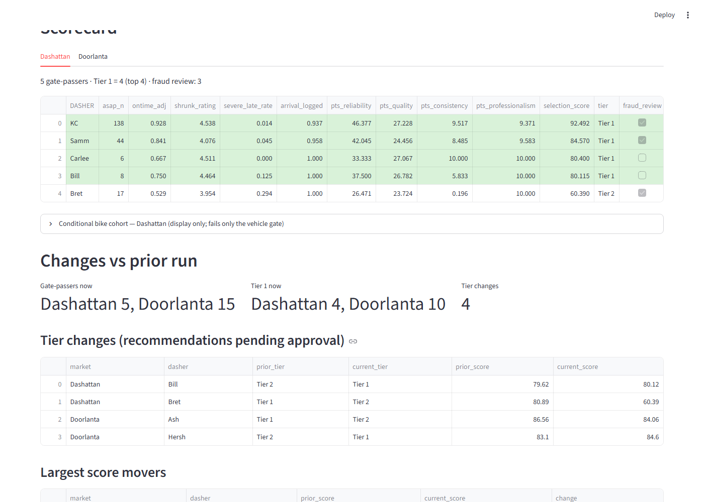

# Widget Dasher Review

A scoring pipeline and review app for selecting Dashers for a widget-delivery launch, built from the
DoorDash case data (`data/2026_Platform_Ops_Widget_Data.xlsx`). The analysis that defined every metric is
`analysis.ipynb`; `pipeline.py` carries that logic as code, `ai.py` adds two explanatory AI stages, and
`app.py` puts a human approval gate on top.

**Creed:** AI interprets and explains; code computes; a human approves.

## Quickstart
    python -m venv .venv && .venv\Scripts\activate      # macOS/Linux: source .venv/bin/activate
    pip install -r requirements.txt
    streamlit run app.py                               # then press "Run with demo data"

Optional: put `ANTHROPIC_API_KEY=...` in `.env` (or Streamlit secrets) to enable the AI panels. Without a
key the app runs in degraded mode and says so; every number on screen comes from `pipeline.py` either way.

## Lock test
    pytest test_lock.py -v
Asserts that `pipeline.run()` reproduces `reference/dasher_scorecard.csv` for all 54 Dashers (gates and
tiers identical, scores within 0.001) and that the Phase 5 sensitivity scenarios still hold.

